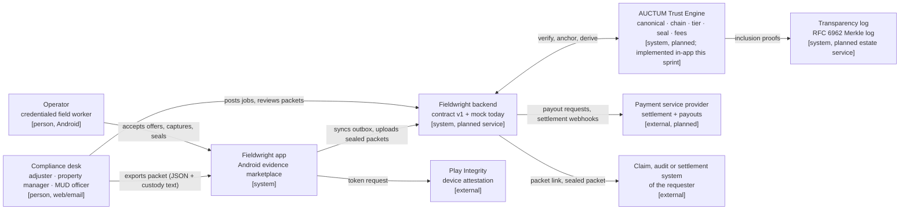
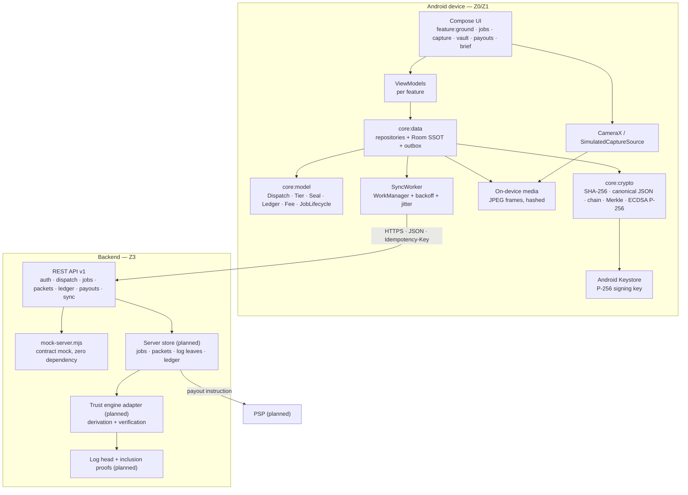
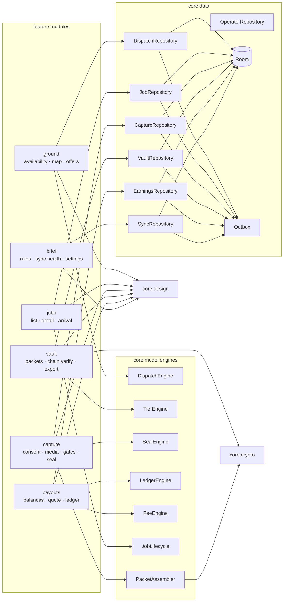
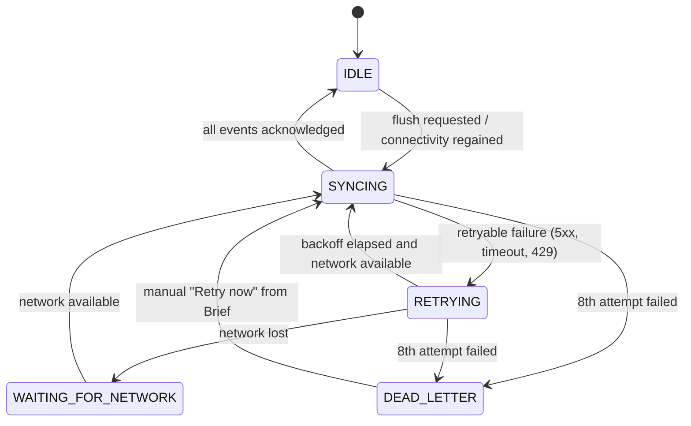
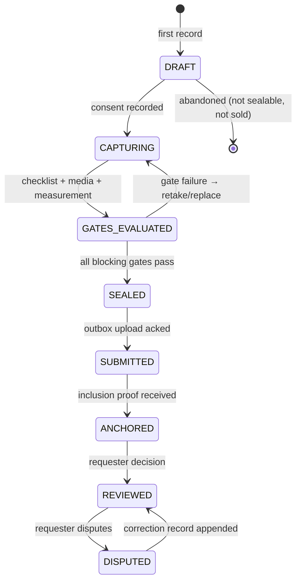
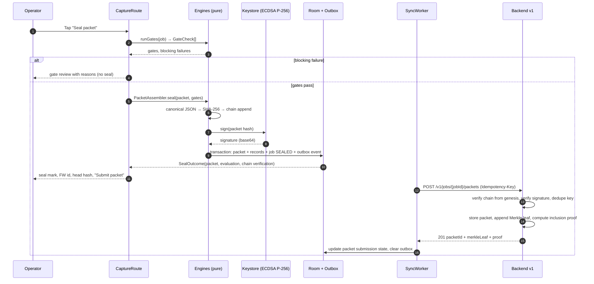
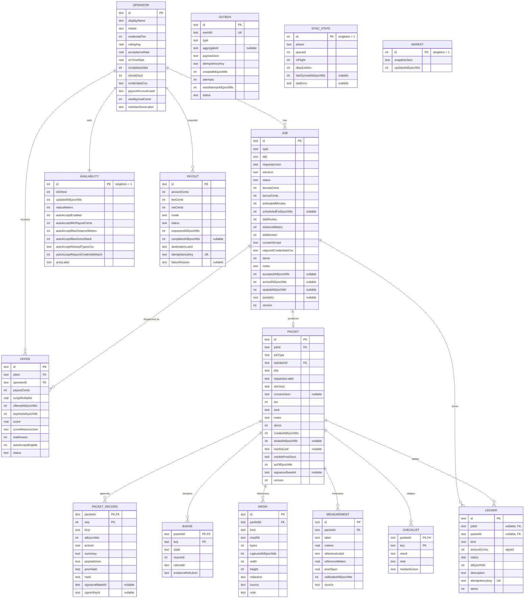

# 01 — Architecture

**Status:** sprint-1 target architecture; module status is marked per row. The contracts in
`docs/CONTRACTS.md` are locked; this document explains *why* the system is shaped this way and
what fails when it is not.
**Audience:** engineering, security review, a technical buyer's due-diligence team.

A note on honesty: the Android app is a **modular monolith** that implements the AUCTUM Trust
Engine contract locally (`core:model`, `core:crypto`). The estate's shared engine package does
not exist yet (`ecosystem/00` §5, `ecosystem/14` R-09). The phone is therefore both client and
verifier for this sprint — which is fine for the product and wrong for the long term. ADR-1 and
ADR-6 in [08-roadmap-and-decisions.md](08-roadmap-and-decisions.md) record that trade.

---

## 1. C4 — level 1: system context



**Text fallback — who talks to whom**

| From | To | What moves | Trust |
|---|---|---|---|
| Operator | Fieldwright app | Consents, frames, measurements, status taps | Device is the evidence origin; app is the operator's tool |
| Compliance desk | Fieldwright backend | Job posts, approvals, disputes | Server is authoritative for money and lifecycle |
| App | Backend | Outbox events, sealed packets, arrival checks, payout requests | Bearer token + device attestation over TLS |
| Backend | Trust engine | Packets to verify, anchor, and price | Internal; engine derives, never stores business data |
| Trust engine | Transparency log | Merkle leaves for public claims | Append-only; public proofs |
| Backend | PSP | Payout instructions, settlement callbacks | Contractual; no card data in our systems |
| App | Play Integrity | Attestation token for `/auth/token` | External attestation, not identity |
| Backend | Requester systems | Packet export link or file | Requester-controlled |

---

## 2. C4 — level 2: containers



**Text fallback — container responsibilities**

| Container | Responsibility | Must never |
|---|---|---|
| `feature:*` Compose UI | Render state, dispatch user intents, show every empty/loading/offline/error state | Re-derive a fee, tier or seal rule; talk to HTTP or Room directly |
| ViewModels | Hold `SavedStateHandle`, call repositories, expose `StateFlow` | Hold `Context`; own business rules |
| `core:data` | Room as single source of truth, repositories, demo market, outbox, sync worker, fake/real HTTP client | Leak Room or HTTP types into features; decide a business rule |
| `core:model` | Pure Kotlin value objects + decision engines; no Android, no I/O, injected `Clock` | Read system time; depend on anything |
| `core:crypto` | SHA-256, canonical JSON, chain append/verify, Merkle leaf/node/proof, ECDSA sign/verify (Keystore adapter + software test signer) | Store keys; log payloads |
| Android Keystore | Generate and hold a P-256 signing key (`KeyGenParameterSpec`), hardware-backed where available | Export private key material |
| `app` | Composition root: manual DI container, nav host, `MainActivity`, repositories wiring | Contain product logic |
| `backend/mock-server.mjs` | Contract-faithful in-memory API: ids, idempotency, ETags, conflicts, deterministic seeds | Pretend to be production (no persistence, no real auth, no ECDSA verification) |
| Backend service (planned) | Persist jobs/packets/ledger, verify signatures and chains, coordinate the log, call PSP | Trust client-asserted tiers or seals |

---

## 3. C4 — level 3: components inside the app



**Text fallback — component rules**

| Component | May call | Must not |
|---|---|---|
| Route composables | Repositories and navigation callbacks passed from `app` | Create a repository; import another feature |
| `CaptureRepository.seal` | `CaptureRepository.runGates` → `SealEngine.evaluate` → `PacketAssembler.seal` → outbox enqueue | Seal when a blocking gate fails; seal when the signer is unavailable |
| `DispatchRepository.refresh` | `DispatchEngine.rank` | Invent weights or an offer TTL |
| `EarningsRepository.requestPayout` | `FeeEngine.quote` + `Idempotency.key` | Compute a fee locally |
| `SyncWorker` | `SyncRepository` contract (fake or HTTP behind one interface) | Mutate packet history to make a retry succeed |
| Any screen | `core:design` tokens/components | Raw hex, raw dp values, third-party UI kits |

---

## 4. Module graph and the dependency rule

```
                       ┌──────────────────────────────┐
                       │            :app              │  composition root, nav, DI
                       └──────────────┬───────────────┘
                                      │ depends on
        ┌──────────────┬──────────────┼───────────────┬──────────────┐
        ▼              ▼              ▼               ▼              ▼
  :feature:ground  :feature:jobs  :feature:capture  :feature:vault  :feature:payouts
        │              │              │               │              │
        └──────────────┴──────┬───────┴───────────────┴──────────────┘
                              ▼
                        ┌───────────┐        ┌──────────────┐
                        │ :core:data│───────▶│ :core:design │  (design has no model dep)
                        └─────┬─────┘        └──────────────┘
                              ▼
                        ┌───────────┐
                        │ :core:crypto│
                        └─────┬─────┘
                              ▼
                        ┌───────────┐
                        │ :core:model│  ← imports nothing outside Kotlin stdlib
                        └───────────┘
```

Rules, enforced by review until a lint rule exists:

1. Dependency arrows are one-way: `app → feature:* → core:data → core:crypto → core:model`.
2. A feature may depend on `core:design` and `core:data`; **never** on another feature.
3. `core:model` imports no Android, no coroutines beyond `fun interface`, no I/O; `Clock` is
   injected. This is what makes dispatch and fee decisions testable without an emulator.
4. `core:design` depends on nothing but Compose. Components take strings, not domain types, so
   the design system can be reused by the estate.
5. Repository interfaces live in `core:data` (`Contracts.kt`) and return `Result` for every
   suspension point, so a screen is forced to render failure.

**Module status at sprint 1**

| Module | Owner | Status | Contents |
|---|---|---|---|
| `app` | Lead | in build | `MainActivity`, `AppContainer` (manual DI), nav routes |
| `core:model` | domain-core | **contract locked, engines being implemented** | vocabularies, engines, catalog, money |
| `core:crypto` | domain-core | being implemented | SHA-256, canonical JSON, chain, Merkle, ECDSA |
| `core:design` | ui-field | tokens + fonts present | tokens, type, components (48 dp targets) |
| `core:data` | data-sync | being implemented | Room schema §8, repositories, demo market, outbox, fake backend |
| `feature:*` | ui-field / ui-capture / ui-vault-money | being implemented | routes + ViewModels, all states |
| `docs`, `backend`, `.github` | docs-gtm | this document set | contract docs, mock server, CI |

---

## 5. Data flow

### 5.1 Read path (UI never touches Room or HTTP)

```
Room ──Flow<Entity>──▶ Repository mapper ──Flow<Domain>──▶ ViewModel StateFlow ──▶ Compose
```

Room is the single source of truth. Server responses are *writes into Room*, not values returned
to the UI. This is why the app shows the same vault content in airplane mode as online.

### 5.2 Write path (every mutation is an outbox event)

```
User intent ──▶ Repository suspending call
                 ├─ 1. validate against the domain engine (pure)
                 ├─ 2. write local row(s) in one Room transaction
                 ├─ 3. enqueue outbox event with a deterministic idempotency key
                 └─ 4. return Result.success(local state)
                        │
                   SyncWorker (WorkManager, network constraint)
                        ├─ drain outbox in order, one in-flight event per aggregate
                        ├─ POST /v1/sync/batch (or dedicated endpoint for packets)
                        ├─ apply server acknowledgement to local rows
                        └─ retry with exponential backoff + jitter (max 8), then dead letter
```

Idempotency keys are derived from canonical inputs (`Idempotency.key(...)`), not random UUIDs, so
a retry of the *same logical operation* is the same key and the server can safely return the
original result. A random UUID per attempt would turn every retry into a duplicate payout risk.

### 5.3 Evidence flow (the part that is not CRUD)

```
capture frames ──SHA-256──▶ MediaRef ──┐
consent signature ─hash──▶ Consent  ──┤
measurement ─────────────▶ Measurement┤──▶ PacketAssembler.draft
checklist results ───────▶ ChecklistResult ──▶ append records (CAPTURE, CUSTODY, ATTEST)
                                              │
                                              ▼
                          gates (blocking) ──▶ SealEngine.evaluate
                                              │  tier 5? badges verified? chain valid?
                                              │  included? as-of present? consent present?
                                              ▼
                          PacketAssembler.seal ──▶ final record + packet hash + ECDSA signature
                                              │
                                              ▼
                          outbox: upload sealed packet ──▶ POST /v1/jobs/{jobId}/packets
                                              │
                                              ▼
                          server verifies chain + signature, appends Merkle leaf
                                              │
                                              ▼
                          inclusion proof stored on packet; seal becomes externally provable
```

---

## 6. Offline-first sync state machine



**Text fallback**

| Phase | Meaning | UI | Transition trigger |
|---|---|---|---|
| `IDLE` | Nothing queued or everything acked | Sync dot ok; "Up to date" | Enqueue, connectivity change, pull-to-refresh |
| `SYNCING` | Worker draining outbox | Sync dot pulsing; in-flight count | All acked → `IDLE`; retryable error → `RETRYING`; fatal → `DEAD_LETTER` |
| `RETRYING` | Backoff with jitter; next attempt scheduled | "Retrying in Ns" | Backoff elapsed → `SYNCING`; network lost → `WAITING_FOR_NETWORK` |
| `WAITING_FOR_NETWORK` | Worker waiting on the network constraint | "Offline — N queued" | Network returns → `SYNCING` |
| `DEAD_LETTER` | 8 attempts exhausted; event requires a human | Brief shows dead letters + "Retry now" | Manual retry → `SYNCING` |

Rules:

- **Ordering.** Events for one aggregate (a packet, a job, a payout) flush in order; unrelated
  aggregates may progress in parallel.
- **No destructive repair.** A sync failure never rewrites local evidence. If a packet upload
  conflicts (`409 PACKET_CONFLICT`), the local packet stays and the Brief surfaces the conflict
  for a human; it is not silently re-sealed with different bytes.
- **Backoff.** Exponential from 2 s with jitter, capped at 5 minutes, max 8 attempts. The cap
  and count are reviewed against the SLO in [05-field-ops-runbook](05-field-ops-runbook.md) §7.
- **Dead-letter is visible.** An invisible dead letter is a silent data loss; it is a P0 in the
  runbook if it exceeds 24 hours.

---

## 7. Evidence lifecycle and seal sequence

### 7.1 Packet state machine (see also [02-domain](02-domain-and-state-machines.md) §4)



**Text fallback**

| State | Artefact exists | Blocking gates | Money effect |
|---|---|---|---|
| `DRAFT` | Empty record list | n/a | none |
| `CAPTURING` | Records appended as work happens | consent required before first capture | none |
| `GATES_EVALUATED` | Complete record set | all gates evaluated | none |
| `SEALED` | Final record + head hash + ECDSA signature | all blocking gates passed | payout becomes owed (ledger `PENDING`) |
| `SUBMITTED` | Server accepted packet, idempotent | chain + signature verified | `PENDING` → `AVAILABLE` on approval |
| `ANCHORED` | Merkle leaf + inclusion proof | none | none |
| `REVIEWED` | Approve/flag decision recorded | none | `APPROVED` → payout eligible |
| `DISPUTED` | Correction records appended | none | payout held per policy |

### 7.2 Seal sequence (client and server)



**Text fallback — seal steps, in order**

| # | Step | Owner | Failure mode | Result on failure |
|---|---|---|---|---|
| 1 | Evaluate blocking gates (consent, geofence or override, redaction resolved, checklist, calibration, chain) | `SealEngine` | Any blocking gate fails | No seal; reasons shown; retake/replace allowed |
| 2 | Canonicalise record set (sorted keys, no whitespace, UTF-8, NFC strings) | `core:crypto` | Non-canonical field | Abort seal; this is a bug, not a user error |
| 3 | Hash previous head + record payload (SHA-256, 64 lowercase hex) | `core:crypto` | Hash mismatch during re-verify | Abort seal; chain is broken |
| 4 | Sign the packet hash with the device key | Keystore | Key unavailable / invalidated | **Fail closed** in release builds; software signer only in debug/test |
| 5 | Append final record, write packet + job + outbox atomically | `core:data` | Room transaction fails | Nothing commits; retry is safe |
| 6 | Upload sealed packet | `SyncWorker` | Offline / 5xx / conflict | Stays queued; conflict goes to Brief; evidence is never rewritten |
| 7 | Server verifies chain + signature; appends leaf; returns proof | Backend | Verification fails | 422 with the failing seq; packet not anchored; operator support ticket |
| 8 | Record inclusion proof, expose verification in Vault | App / backend | Log unavailable | Packet remains `SUBMITTED`; verification surfaces "log unreachable", never a false "verified" |

---

## 8. Data model — Room schema (target)

`core:data` owns this schema. Column names are the implementation contract; the API uses the
matching wire names from [03-api-contract](03-api-contract.md). Money columns are `INTEGER`
cents. Time columns are `INTEGER` epoch milliseconds. Hashes are `TEXT` with 64 lowercase hex
characters. `Encryption at rest is not enabled in sprint 1` (ADR-8).



**Text fallback — tables and cardinality**

| Table | Purpose | Key | Cardinality / notes |
|---|---|---|---|
| `operator` | The signed-in worker | `id` | exactly one row (single-operator app); credentials as CSV of enum names |
| `availability` | Online state, radius, auto-accept policy | singleton `id = 1` | one row |
| `jobs` | Server-authoritative job mirror | `id` | one row per job seen; `version` for optimistic conflict display |
| `offers` | Time-boxed dispatch offers | `id` | many per job; expired offers retained for the Done/declined history |
| `packets` | Sealed/ draft evidence packets | `id` | 0..1 per job; sealed packets are never deleted |
| `packet_records` | Append-only chain | `(packetId, seq)` | seq gap-free from 1; the only place hashes live |
| `badges` | Declared claims and state | `(packetId, key)` | one row per `BadgeKey` relevant to the job type |
| `media` | Hashed frame references | `id` | many per packet; bytes are not in the DB |
| `measurements` | Calibrated dimensions | `id` | many per packet |
| `checklist` | Per-step results | `(packetId, key)` | one row per checklist step in the job family |
| `ledger` | Signed money movements | `id`; unique `idempotencyKey` | append-only; reversal is a new entry, never an edit |
| `payouts` | Payout requests | `id`; unique `idempotencyKey` | status machine `REQUESTED → PROCESSING → PAID/FAILED/CANCELLED` |
| `outbox` | Pending sync events | `id`; unique `eventId` | unique `eventId` makes re-enqueue safe |
| `sync_state` | UI flags for sync health | singleton `id = 1` | derived counters, rebuildable |
| `market` | Last market snapshot | singleton `id = 1` | display only; never used to make a money decision offline |

**Derived, not stored:** gates (`GateCheck`), tiers (`EvidenceTier`), badge states, balances,
and `Job.payoutCents`/`dollarsPerHour`. If a derived value is persisted as truth, two screens
can disagree; the engines are the only source. `seal` *is* stored because it is a decision made
at a point in time with a signature; it is always re-evaluable from records.

---

## 9. Security zones

| Zone | Contents | Trust boundary | Controls |
|---|---|---|---|
| **Z0 — Device secure hardware** | Keystore private key | Key never leaves the TEE/StrongBox | `KeyGenParameterSpec` P-256, user-auth not required for background signing, hardware attestation where available, no export |
| **Z1 — App process / local data** | Room DB, outbox, on-device media, consent names | Device may be lost, rooted or shared | Screen-off lockout for vault screens; no logging of consent names/payloads/signatures; media hashed before use; Room encryption is **roadmap** (ADR-8) |
| **Z2 — Transport** | HTTPS to backend | Network attacker | TLS 1.2+ only, certificate pinning roadmap, device attestation token on `/auth/token`, no background location |
| **Z3 — Backend API** | Jobs, packets, ledger, payouts | Internet-facing service | Bearer token + attestation, per-token rate limits, idempotency keys, server-side state machine, signature + chain verification before accepting a packet |
| **Z4 — Estate services** | Transparency log, PSP | Vendor/estate boundary | Log is append-only with public proofs; PSP receives payout instructions only (no card data in our systems) |

Trust-boundary rules that are product requirements, not aspirations:

1. **The client is untrusted for truth.** A client may submit records, never a tier, badge state
   or seal. Those derive server-side (or in the app for local preview, re-derived on upload).
2. **Money is server-authoritative.** Payout amounts are validated against the server ledger,
   not the local one. A client that says "pay me $9,999" receives `422 INVALID_AMOUNT`.
3. **Demo is never public.** `demo = true` rows are excluded from any log anchor and rendered as
   "SAMPLE — excluded from log" (estate invariant I-4).

---

## 10. Failure modes and mitigations

| Failure | Blast radius | Detection | Mitigation | Residual risk |
|---|---|---|---|---|
| No camera / permission denied | Capture blocked | Permission state | `SimulatedCaptureSource` with a visible "SIMULATED" label; seal allowed only when the job is marked demo | A simulated packet must never enter the log; enforced by `demo` flag |
| Keystore key invalidated (biometric change, restore) | Sealing impossible | `SignatureScheme` error | Release build fails closed with a named reason + support path; key re-provision on next auth | Operator cannot seal until re-provisioned |
| Clock skew or manual clock change | Chain timestamps untrustworthy | Server compares `atEpochMs` to receipt time | Server records `receivedAt`, flags skew > 5 min, packet review queue | Skewed clock can still be signed; flag is the defence |
| Geofence inaccurate (urban canyon) | False "not arrived" | `accuracyMeters` recorded | Arrival uses `distance ≤ radius + accuracy` capped at 100 m; override records a reason and flags the packet | An override is honest but weaker evidence; shown in review |
| Redaction unresolved | Privacy breach if exported | `MediaRef.redaction` state | Blocking gate; export refuses until `APPLIED` or `NOT_NEEDED` | Operator could mark `NOT_NEEDED` incorrectly; audit sample |
| Outbox item > 8 attempts | Evidence sits unsynced | `sync_state.deadLetters` | Visible in Brief; "Retry now"; runbook escalation | Device loss before retry loses local packet (media still on device only) |
| Duplicate upload after retry | Double anchoring | Idempotency key + packet hash | Server returns the original result for the same key; `409 PACKET_CONFLICT` for same job different hash | Client bug could produce two keys; hash conflict catches it |
| Server 5xx during packet upload | Packet unanchored | HTTP status | Queue with backoff; no local mutation | Anchor latency delays review |
| Chain break (bug or tamper) | Evidence inadmissible | Re-verify on open, export and upload | Never repair silently; freeze packet; incident runbook | Historical packets already exported cannot be recalled |
| Room DB corruption | Local loss | Open failure / integrity check | Export-first guidance; rebuild from server for jobs, but **local media may be lost** | Unuploaded evidence is lost; documented in runbook |
| Log unavailable | Seal cannot be externally proven | Proof request failure | Vault says "log unreachable"; never claims verification | Delayed review |
| PSP outage | Payouts delayed | Payout status | Payouts queue as `PROCESSING`; standard ACH fallback; in-app reason | Worker trust damage if > 1 business day |
| Provider/attestation failure | Login blocked | `/auth/token` 403 | Retry, then support path; no bypass in release builds | Operator locked out on misconfigured device |
| Market snapshot stale | Wrong offers displayed | `market.updatedAtEpochMs` age | Offers expire in 45 s server-side; stale UI cannot accept an expired offer (`409`) | Noise, not money loss |

---

## 11. Performance and size budgets (targets, not measurements)

| Budget | Target | Rationale |
|---|---|---|
| Cold start to Ground first frame | ≤ 1.5 s on a mid-range device | Field workers open the app at the kerb |
| Offer render + accept tap | ≤ 120 ms interaction | 45 s TTL is short; hesitation is unpaid |
| Seal computation (hash + sign + DB transaction) | ≤ 400 ms | The seal is the product moment; must feel instant |
| Vault list with 200 packets | ≤ 100 ms scroll frames | Media thumbs are hashes + local thumbnails |
| Outbox flush of 25 events | ≤ 4 s on LTE | p95 SLO < 10 s end-to-end |
| APK size | ≤ 20 MB | CameraX + Compose + Room only; fonts subset per script |

These are **budgets to verify**, not measured results. The CI workflow in
`.github/workflows/android.yml` builds and tests; perf baselines are a roadmap item.

---

## 12. What this architecture deliberately does not do

| Not done | Why | Follow-up |
|---|---|---|
| No microservices | One app, one API, one ledger; a distributed system at this stage would multiply failure modes without changing the product | Split only when packet upload and payout volumes diverge by >10× |
| No cloud sync engine (Firebase/Firestore) | Room must remain the SSOT for evidence; a conflict-free replication layer would hide the very conflicts we must surface | Outbox is explicit and inspectable |
| No client-side ECDSA verification of other parties | The app verifies its own chain; the estate verifier is a later deliverable | Server verification + browser verifier per `ecosystem/04` C-04 |
| No certificate pinning in sprint 1 | Pinning without an ops rotation process creates outages | ADR follow-up; pin with backup pins before production |
| No analytics SDK | Evidence app must not ship third-party telemetry; consent and payload leakage risk | Aggregate counters derived server-side only |
