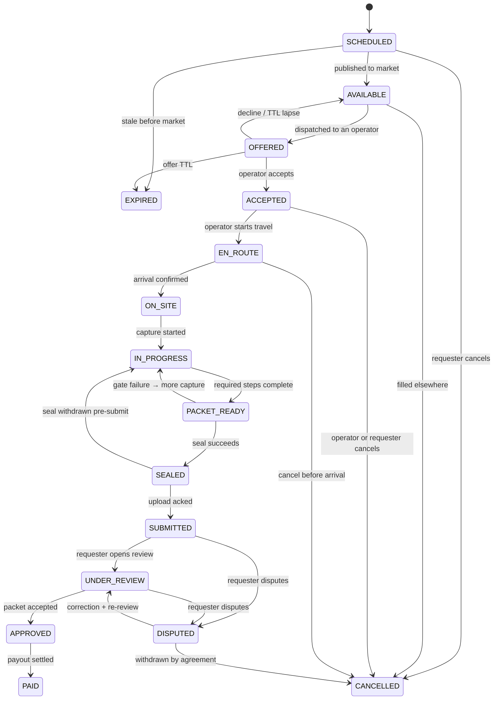
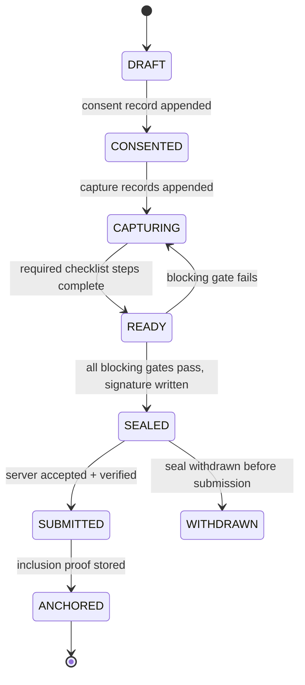
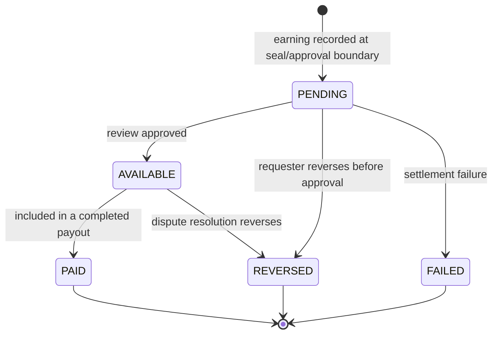
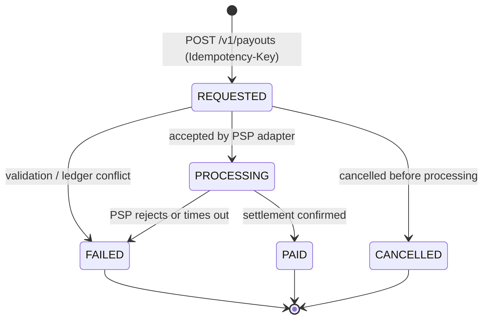

# 02 — Domain and state machines

**Status:** domain contract. The authoritative transition table is `JobLifecycle.transitions` in
`core/model/.../Engines.kt`; this document explains it, shows the machines the code implements,
and names the invariants that must not be violated by any future change.
**Source of truth order:** code → this document → UI copy. If they disagree, the code wins and
this file is a defect.

---

## 1. Vocabulary (the estate's, applied to field work)

| Term | Meaning in Fieldwright | Not this |
|---|---|---|
| **Record** | An appended, hash-linked act: `CAPTURE`, `ATTEST`, `CUSTODY`, `INSPECTION`, `PAYMENT`, `CORRECTION` | Not a row that can be edited |
| **Chain** | Per-packet hash chain, genesis = 64 zeros, `hash = SHA-256(canonicalJson)` | Not a blockchain, not a token |
| **Tier** | Derived from records only: 1 Reported → 5 Verified by AUCTUM | Not a percentage, not assigned |
| **Badge** | A declared claim with state `MISSING / IN_REVIEW / VERIFIED / FLAGGED / WAIVED` | Not a tier |
| **Seal** | `PENDING / EARNED / FLAGGED / WITHDRAWN`; earned only when tier 5 **and** all required badges verified **and** chain valid **and** included **and** as-of present | Not a sticker, not permanent |
| **Packet** | The sellable artefact: consent + records + badges + media refs + measurements + gates + signature | Not a folder of photos |
| **Offer** | Time-boxed dispatch offer, 45 s TTL | Not an assignment |
| **Job** | The priced unit of work with a lifecycle | Not a project |
| **Ledger** | Append-only money movements with idempotency keys | Not a balance field |
| **Consent** | A record: name, role, scope, method, time, signature hash | Not a checkbox or a waiver |

---

## 2. Job lifecycle

### 2.1 The machine (mirrors `JobLifecycle` exactly)



**Text fallback — allowed transitions (the exact map in `JobLifecycle`)**

| From | Allowed next | Notes |
|---|---|---|
| `SCHEDULED` | `AVAILABLE`, `CANCELLED`, `EXPIRED` | Scheduled work not yet public |
| `AVAILABLE` | `OFFERED`, `CANCELLED` | Only one offer outstanding at a time |
| `OFFERED` | `ACCEPTED`, `AVAILABLE`, `EXPIRED` | Decline or TTL returns the job to the pool |
| `ACCEPTED` | `EN_ROUTE`, `CANCELLED` | Accepting is not starting |
| `EN_ROUTE` | `ON_SITE`, `CANCELLED` | `ON_SITE` requires an arrival record |
| `ON_SITE` | `IN_PROGRESS` | Capture may only begin on site |
| `IN_PROGRESS` | `PACKET_READY` | Requires required steps complete |
| `PACKET_READY` | `SEALED`, `IN_PROGRESS` | Sealing is reversible until submission |
| `SEALED` | `SUBMITTED`, `IN_PROGRESS` | Pre-submit withdrawal is possible; post-submit is not |
| `SUBMITTED` | `UNDER_REVIEW`, `DISPUTED` | |
| `UNDER_REVIEW` | `APPROVED`, `DISPUTED` | |
| `APPROVED` | `PAID` | Terminal |
| `DISPUTED` | `UNDER_REVIEW`, `CANCELLED` | Dispute is not a dead end |
| `PAID`, `CANCELLED`, `EXPIRED` | none | `JobStatus.isTerminal` |

**Text fallback — terminal and active sets**

| Predicate | Statuses |
|---|---|
| `isTerminal` | `PAID`, `CANCELLED`, `EXPIRED` |
| `isActive` | `ACCEPTED`, `EN_ROUTE`, `ON_SITE`, `IN_PROGRESS`, `PACKET_READY`, `SEALED`, `SUBMITTED` |
| `isOpenForCapture` | `ON_SITE`, `IN_PROGRESS`, `PACKET_READY` |

### 2.2 Why these specific choices

| Decision | Reason | Failure if reversed |
|---|---|---|
| Accepting does not start the drive | The operator may have a second job ahead; `EN_ROUTE` is an explicit intent and gives dispatch a real ETA | SLA clock starts before work does; on-time metrics become fiction |
| `ON_SITE` needs an arrival record with a geofence check | The arrival is evidence; a fabricated one is the fastest way to lose a dispute | "I was there" becomes an assertion with nothing behind it |
| Capture only opens on site | Prevents capture of a site from memory or from a different address | The packet no longer proves the site |
| Sealing is reversible until submission | Mistakes in scope are recoverable before they become public claims | Operator is stuck with a wrong packet or forced to edit (which is forbidden) |
| No transition from `SUBMITTED` back to capture | The server already has the bytes; a second seal would be a second artefact with a different hash | Two "final" packets for one job; dispute chaos |
| `DISPUTED` returns to `UNDER_REVIEW` | Disagreement is resolvable with a correction record | Disputes become payout denials |
| No direct `APPROVED → CANCELLED` | Once the requester accepts, money is owed | Cancelling after approval is wage theft with a state machine |

### 2.3 Transition guard functions (server-side)

Every transition endpoint enforces all of the following, in order:

1. **Authentication.** Bearer token + valid device attestation.
2. **Aggregate version.** `If-Match` on the job; mismatch → `412 PRECONDITION_FAILED` before any
   rule runs.
3. **Legal transition.** `JobLifecycle.canTransition(from, to)`; else `409 JOB_STATE_INVALID`
   with the current status and the allowed list.
4. **Ownership.** Only the assigned operator (or the requester org) may drive the transition.
5. **Domain preconditions.** Example: `IN_PROGRESS → PACKET_READY` requires every required
   checklist step in a terminal result and consent present.
6. **Audit.** Append the transition to the server event log with actor, time, and idempotency key.

---

## 3. Dispatch and offers

### 3.1 Ranking model (`DispatchEngine.WEIGHTS`)

| Component | Weight | What it measures | Data source | Deliberate limitation |
|---|---:|---|---|---|
| Proximity | 0.30 | Distance from operator fix to site | `GeoMath.distanceMeters` | Bearing is not used; no traffic model |
| Payout | 0.25 | Offer payout relative to the market | `Job.payoutCents × surge` | Does not model operator's income target |
| Urgency | 0.15 | SLA pressure / scheduled window | `slaMinutes`, `scheduledForEpochMs` | No slot optimisation |
| Credential | 0.15 | Match between job requirement and operator credentials | `JobType.requiredCredentials` vs `Operator.credentials` | A hard gate, not just a score |
| Reliability | 0.10 | Acceptance and on-time history | `Operator.acceptanceRate`, `onTimeRate` | New operators neutral by design |
| Fairness | 0.05 | Exposure rotation across eligible supply | Server-side assignment history | Cannot fix a market with too little supply |

Constraints (hard, not weighted): offer TTL **45 s** (`OFFER_TTL_MS`), maximum **3** active jobs
(`MAX_ACTIVE_JOBS`), offer radius **≤ 25 km** (`MAX_OFFER_RADIUS_METERS`), minimum payout **$25**
(`MIN_PAYOUT_FLOOR_CENTS`), fatigue cap **600 min** (`FATIGUE_CAP_MINUTES`).

**Why the weights sum to 1.0 and live in data.** A pricing or dispatch experiment must be
reviewable as a diff, not inferred from behaviour. Every weight change needs a note in the ADR
log and a before/after acceptance-rate read.

**Ranking is never a mystery box.** `DispatchResult.rejected` carries `(job, reason)` for every
job that was not offered, so the Ground screen can explain "5 km away, roof certification
missing" instead of silently showing nothing. Rejections are product truth, not debug output.

### 3.2 Offer sequence

```mermaid
sequenceDiagram
    autonumber
    participant W as Worker app
    participant S as Server dispatch
    participant M as Market simulator
    participant O as Operator

    M->>S: demand/supply snapshot (hot zones, surge 1.0–1.6)
    S->>S: rank eligible jobs for operator (weights §3.1)
    S->>W: offer pushed (payout, surge, TTL 45 s, score reasons)
    W->>O: offer card + countdown
    alt operator accepts in time
        O->>W: Accept
        W->>S: POST /v1/offers/{id}/accept (Idempotency-Key)
        S->>S: re-check TTL, active-job cap, credential gate
        S-->>W: 200 job ACCEPTED + acceptedAt
        S->>S: ledger: nothing yet (money on seal/approval)
    else operator passes
        O->>W: Pass (reason)
        W->>S: POST /v1/offers/{id}/decline
        S->>S: offer DECLINED; job back to AVAILABLE; next candidate
    else TTL expires
        S->>S: offer EXPIRED at expiresAt (server clock)
        S->>W: expiry event; offer disappears from the list
    end
```

**Text fallback — offer status machine**

| From | To | Trigger | Side effect |
|---|---|---|---|
| `PENDING` | `ACCEPTED` | Operator accept (before `expiresAt`) | Job `OFFERED → ACCEPTED`; one active job added |
| `PENDING` | `DECLINED` | Operator pass with a reason | Job `OFFERED → AVAILABLE`; offer retained for history |
| `PENDING` | `EXPIRED` | Server clock passes `expiresAtEpochMs` | Job `OFFERED → AVAILABLE`; offer retained |
| `PENDING` | `WITHDRAWN` | Dispatch withdraws (job cancelled, credential revoked) | Job returns or cancels |
| any terminal | — | — | Terminal; an expired offer cannot be accepted later (`409 OFFER_EXPIRED`) |

**Concurrency rule.** Two offers for the same job can never both be `PENDING`; accepting one
cancels the other as `WITHDRAWN`. On the server, accept is a compare-and-set on the offer status
inside a transaction. In the mock server this is the `OFFER_TAKEN` conflict.

### 3.3 Auto-accept is a written policy, not a vibe

`AutoAcceptPolicy` fields and what each one means:

| Field | Default | Meaning | Why it must be explicit |
|---|---:|---|---|
| `enabled` | true | Policy active | An unread auto-accept is not consent |
| `minPayoutCents` | 3000 ($30) | Never accept below this | Protects the worker from convenience-job creep |
| `maxDistanceMeters` | 12000 (12 km) | Never accept beyond this | Drive time is unpaid |
| `maxActiveStack` | 2 | Maximum concurrent accepted jobs | Prevents over-stacking that misses SLAs |
| `allowedTypes` | all | Job families the operator will auto-accept | Credentialed work is not interchangeable |
| `requireCredentialMatch` | true | Refuse offers that need a missing credential | A blocked accept is worse than no accept |

`DispatchEngine.autoAccept` returns `AutoAcceptDecision(accept, reason)`. Every automatic accept
*and* every automatic pass writes a reason. The Ground screen shows the policy in one line:
"Auto-accept under $30 · max 2 stacked". Changing it is a two-tap operation with the new policy
shown before it takes effect.

### 3.4 Surge disclosure

`MarketSnapshot.surgeMultiplier` is computed from demand and supply indices, clamped to
**1.0–1.6**. The offer card shows the multiplier and the resulting payout before acceptance; the
worker is never asked to accept an undisclosed multiplier. Surge never applies retroactively to
an accepted job.

---

## 4. Packet state machine

The packet is the product. Its states are about *what has been proven and signed*, not about
UI progress.



**Text fallback — packet states and required evidence**

| State | Required to enter | What the requester sees |
|---|---|---|
| `DRAFT` | Job accepted, packet created | nothing |
| `CONSENTED` | `Consent` record with name, role, scope text, method, time, signature hash | nothing |
| `CAPTURING` | ≥1 `CAPTURE` record; media hashed; checklist progressing | nothing |
| `READY` | All required checklist steps terminal; measurements calibrated | nothing (seal not yet earned) |
| `SEALED` | Tier 5, all required badges `VERIFIED`, none `FLAGGED`, chain valid, included, as-of present, ECDSA signature | seal mark, packet id, head hash, "submitted" status once uploaded |
| `SUBMITTED` | Server verified chain from genesis + signature; Merkle leaf appended | packet in Vault, chain verification available |
| `ANCHORED` | Inclusion proof stored | "included in log" with proof |
| `WITHDRAWN` | Seal withdrawn pre-submission (e.g. correction invalidates a badge) | not listed as sealed; evidence retained |

**Rules that cannot be relaxed:**

1. **No consent → no seal.** `SealEngine.evaluate` returns a blocking reason; the seal button is
   disabled and the reason is named.
2. **A `FLAGGED` badge blocks the seal** and blocks the market transition, not just the UI.
3. **The seal is re-evaluated on every open.** A stored `SEALED` with a broken chain must be
   shown as flagged, not trusted because it was stored once.
4. **Corrections are records.** A `CORRECTION` record supersedes an earlier record by reference;
   it never edits or deletes it, and it can lower the tier.
5. **Seal can be withdrawn.** A reversed payment or voiding correction lowers the tier and
   re-evaluates the seal. Money does not follow it down (invariant I-1, §6).

---

## 5. Ledger and payout state machines

### 5.1 Ledger entry lifecycle



**Text fallback**

| From | To | Trigger | Money consequence |
|---|---|---|---|
| — | `PENDING` | Job `SUBMITTED` or approval boundary | Owed but not withdrawable |
| `PENDING` | `AVAILABLE` | Packet approved | Withdrawable |
| `AVAILABLE` | `PAID` | Payout request completes | Leaves available balance |
| `PENDING`/`AVAILABLE` | `REVERSED` | Dispute resolution or PSP reversal | A **new** negative entry; the original is untouched |
| any | `FAILED` | Settlement failure | Surfaced with a reason code; retryable |

Kinds (`LedgerKind`) and signs: `EARNING` +, `BONUS` +, `TIP` +, `INSTANT_FEE` −,
`ADJUSTMENT` ±, `REVERSAL` −. Amounts are signed integer cents.

### 5.2 Balances are derived, not stored

```
availableCents = Σ amountCents where status = AVAILABLE      (not yet paid)
pendingCents   = Σ amountCents where status = PENDING
paidLifetimeCents = Σ amountCents where status = PAID (earnings only)
```

`instantFeePaidLifetimeCents` is the sum of `INSTANT_FEE` entries. A balance is never a column
that can drift; `LedgerEngine.balances` recomputes from entries every time. This is why a failed
sync cannot create money.

### 5.3 Payout state machine



**Text fallback — payout rules**

| Rule | Enforcement |
|---|---|
| Amount is integer cents, `> 0`, `≤ availableCents` | Server validates against ledger; else `422 INVALID_AMOUNT` |
| Fee is computed once, at quote time, from `FeeSchedule` | `FeeEngine.instantPayoutFeeCents`: 1.5%, min $0.50, max $5.00 |
| `netCents = amountCents − feeCents`, never negative | Invariant; a min fee larger than the amount is rejected |
| Every request carries an idempotency key derived from canonical inputs | Retry returns the same `PayoutRequest` |
| A `FAILED` payout is retryable with a **new** key only after the failure is acknowledged | Prevents duplicate settlement on transient PSP errors |
| Standard ACH is free; instant is capped and disclosed | `PayoutMode.STANDARD` / `INSTANT` |
| Destination is last-4 only in the app and logs | No full account number in our systems |

### 5.4 Fee arithmetic (the exact equations)

```
platformFeeCents  = floor((payoutCents × 1500 + 5000) / 10000)      // half-up, once
instantFeeCents   = clamp(floor((amountCents × 150 + 5000) / 10000), 50, 500)
netCents          = amountCents − instantFeeCents
mileageDeduction  = round(miles × 70)                                // estimate only
```

Examples: $450.00 payout → $67.50 platform fee; $450.00 instant payout → $6.75 raw fee, capped
$5.00 → $445.00 net; $28.00 instant payout → $0.50 minimum fee → $27.50 net.

---

## 6. Invariants

Violating any invariant is a P0 defect, not a bug with a workaround.

| ID | Invariant | Where enforced | How to test |
|---|---|---|---|
| **INV-1** | **Money and evidence move independently.** A bad evidence outcome never silently reverses a payout; a reversal never deletes a record | Separate ledgers; reversal entries are new records; tier can fall without money moving | Seal a packet, reverse a payment, assert tier 4 and ledger `REVERSED` entry, evidence unchanged |
| **INV-2** | **Records are append-only.** Corrections are records; nothing is edited or deleted | `packet_records` has no update path; repository exposes only append and correction | Attempt to update a record hash → no API; correction increases `recordCount` |
| **INV-3** | **No consent, no seal.** The consent record is a precondition of sealing, not a UI step | `SealEngine.evaluate` blocking gate; server re-checks on upload | Seal with consent unset → blocked with named reason |
| **INV-4** | **Demo data never enters the log or a public surface** | `demo = true` excluded from anchors; UI renders "SAMPLE — excluded from log" | Anchor a demo packet → server refuses; export labels it |
| **INV-5** | **Every money figure carries its disclosure** | `PayoutQuote.feeDisclosure`; requester invoice line; platform fee note | Render a payout quote without disclosure → test fails at the design-system level |
| **INV-6** | **No client-asserted tier, badge state or seal** | Server derives/validates on upload; API has no such write fields | POST a packet with `tier: 5` altered → server rejects at verification |
| **INV-7** | **Hashes are 64 lowercase hex; signatures verify against a known key id** | `core:crypto`; server upload verification | Inject a 63-char hash → validation failure; tamper one byte → broken at correct `seq` |
| **INV-8** | **Transitions are legal or refused.** Screens ask; they do not assume | `JobLifecycle.canTransition`; server 409 | For each pair in the matrix, assert allowed/blocked; assert no status can skip approval to `PAID` |
| **INV-9** | **Idempotency is deterministic.** Same logical operation → same key; same key + same body → same result; same key + different body → conflict | `Idempotency.key`; server idempotency store | Retry accept twice → one accepted job, identical response; same key different body → `422 IDEMPOTENCY_KEY_REUSED` |
| **INV-10** | **A worker payout is never reduced by the platform fee** | Fee is computed from the payout and charged to the requester | Assert `netCents` equals `amountCents` minus only the optional instant fee |

---

## 7. Anti-patterns observed in the source material (kept out of the domain)

| Anti-pattern | Source | Why it is excluded |
|---|---|---|
| "The worker's role ends at upload" | `ecosystem/14` R-08 (Vanguard plan) | Contradicts tier 3–4 duties: a capturer who measures and attests is an attestor and must be modelled as one. Fieldwright models the operator as the capture author and records the signed attestation upstream |
| "Instant payout to wallet" as a current feature | `ecosystem/14` R-08/R-16 | No live rail exists. The app shows a payout *request* with a PSP status, never a promise of settled money |
| Fee constant hard-coded per market | `ecosystem/14` R-01 | Fee is `FeeSchedule` data; a market can change its rate without a code change, and every quote carries its own disclosure |
| Tier as a completion bar | `ecosystem/05` §3a | Tier is a named state with reasons; a percentage implies an attained completeness that a record set cannot have |
| "Flagged" softened to amber | `ecosystem/05` §8 | `FLAGGED` blocks the seal and the market transition. It is the most important signal in the domain and is never a warning tone |
| Editing a packet to fix a typo | anywhere | A correction record is the only repair. The chain's meaning depends on it |

---

## 8. Where the domain is tested

| Test area | What must be asserted | Owner |
|---|---|---|
| Job lifecycle | Every allowed pair passes, every other pair is refused, terminal states have no exits | domain-core |
| Dispatch | Weights sum to 1.0; radius/floor/cap constraints are hard; rejection reasons present; TTL arithmetic | domain-core |
| Tier derivation | Tier 1–5 from record sets; decreasing tier on reversal/correction; no percentage | domain-core |
| Seal | Each precondition independently blocks; reasons name the failing condition; `canSeal` only at tier 5 + badges + chain + inclusion + as-of | domain-core |
| Fees | Rounding half-up; min/max instant fee; platform fee payer/amount; no float drift on 10,000 random cents values | domain-core |
| Ledger | Balances from entries; reversal not edit; payout net never negative; idempotent retry | domain-core + data-sync |
| Chain | Genesis is 64 zeros; tamper detected at correct seq; canonical JSON stable across key order; Merkle inclusion verifies | domain-core |
| Consent gating | Seal blocked without consent; consent record immutable; consent scope text preserved verbatim in the packet | ui-capture + domain-core |
