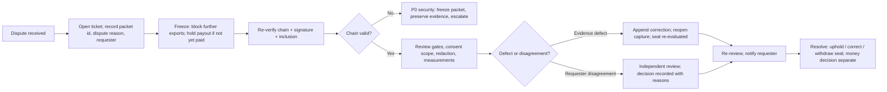

# 05 — Field operations runbook

**Audience:** city lead (field ops), trust & safety, finance ops, engineering on-call.
**Purpose:** the procedures a small team can actually follow at 06:40 on a Monday, with the
SLIs and thresholds that say when to escalate.
**Read with:** [04-security](04-security-privacy-consent.md) (incident response), [02-domain](02-domain-and-state-machines.md) (states), [03-api](03-api-contract.md) (errors).

Conventions: all times UTC unless a local window is named. "Worker" = operator. "Desk" =
requester's compliance desk. Every action that changes money or a packet gets a ticket id in the
timeline.

---

## 1. Roles

| Role | Owns | On-call? |
|---|---|---|
| City lead | Supply liquidity, onboarding, dispatch health, dispute queue first responder | Business hours + escalation |
| Trust & safety (T&S) | Consent/redaction failures, flagged badges, account suspension, disputed packets | Escalation, 7 days |
| Finance ops | Ledger reconciliation, payout failures, PSP exceptions, 1099 reporting | Escalation, business hours |
| Engineering on-call | API/app availability, sync SLO, upload failures, dead-letter queue | 24/7 during pilot |
| Incident commander | Declared per P0/P1 incident; not a standing role | Per incident |

Single-person coverage is a known risk during the pilot. The coverage rule is: **no money movement
decision is made alone**; a second person (finance ops or the lead) approves any manual payout
correction.

---

## 2. Onboarding a worker

Target: 20 minutes of desk time plus a 1-hour ride-along. Do not onboard a worker who cannot
produce a verifiable credential for the work they will be offered.

### 2.1 Steps

| # | Step | Owner | Done when |
|---|---|---|---|
| 1 | Identity check: government ID + selfie match (in person or video) | City lead | Name and photo match; DOB verified |
| 2 | W-9 collected (1099 contractor), entity name and TIN verified against the W-9 | Finance ops | W-9 stored in the restricted finance store, not the app |
| 3 | Credential verification per §3 | City lead | Each credential has a document, issuer, expiry and verifier initials |
| 4 | Insurance: certificate of general liability naming the operator; limits per city policy | Finance ops | Certificate on file, expiry logged |
| 5 | Payout account: bank/debit destination, last 4 recorded; micro-deposit or PSP verification | Finance ops | PSP confirms the account; last 4 matches |
| 6 | Install app, sign in, pass attestation, complete a demo-mode capture end to end | City lead | Demo packet seals locally and shows "SAMPLE — excluded from log" |
| 7 | Read the operating rules in Brief and acknowledge: consent rules, fee schedule, what Fieldwright never does | Worker | Acknowledgement recorded |
| 8 | Shadow one live job with an experienced operator (not counted in SLA) | City lead | Debrief notes filed |
| 9 | Activate dispatch for the worker's credentials and radius | City lead | First offer received |

**Never** during onboarding: promise a minimum weekly income (unless the pilot guarantee in
[07-gtm](07-gtm-launch-playbook.md) applies and is written down), create availability on the
worker's behalf, or accept an offer for them. Those are employment indicia and a product-integrity
failure at the same time (see [00-product-brief](00-product-brief.md) R1).

### 2.2 Onboarding evidence pack (store in the restricted HR/contractor store)

| Document | Required | Retention |
|---|---|---|
| Government ID image | Yes | Account + 12 months |
| W-9 | Yes | 7 years |
| Credential certificates / licences | Yes, per job family | Account + 7 years |
| Insurance certificate | Yes | Account + 7 years |
| Signed independent-contractor agreement | Yes | 7 years |
| App operating-rules acknowledgement | Yes | Account + 7 years |
| Ride-along debrief | Yes | 24 months |

---

## 3. Credential verification

The app's `Credential` enum defines what can be required. Verify against the issuer, not against a
photograph of a card alone.

| Credential (enum) | Proves | Verification method | Expiry handling |
|---|---|---|---|
| `RPZ_BACKFLOW_TESTER` | Annual RPZ/backflow assembly testing | State/certifying body lookup or the MUD's approved-tester list; certificate number and expiry | Notification 60/30/7 days before expiry; dispatch auto-excludes on expiry |
| `ROOF_SAFETY` | Roof safety certification (fall protection) | Training provider verification; certificate number | Same |
| `PROPERTY_INSPECTOR` | Property inspection competence | Issuing association or employer attestation | Same |
| `NOTARY` | Notarial authority (where a job needs an acknowledgment) | State commission lookup, commission expiry | Same |
| `DRONE_PILOT` | Part 107 remote pilot | FAA Airman certificate lookup | Same |

Rules:

1. **Expiry removes eligibility automatically.** A worker with an expired credential is not
   offered work that requires it; the app hides it and the server rejects an accept with
   `403 CREDENTIAL_REQUIRED`.
2. **No override without a recorded reason.** A city lead may override for a pilot only with the
   credential document attached and a named approver; the override is logged and expires in 14 days.
3. **A credential never gates a payout.** It gates offers, not money (invariant I-1).
4. Suspended/revoked credentials are treated like expiry, immediately.

---

## 4. Dispatch troubleshooting

### 4.1 Diagnostic order

Always: (1) is the worker online and in radius, (2) is there eligible demand, (3) is the offer path
healthy, (4) is it a policy/credential block. Do not start by changing weights.

| Symptom | Check | Likely cause | Action |
|---|---|---|---|
| Worker online, no offers | `GET /offers`; market snapshot; eligible job list | No supply in radius, or all jobs need a credential the worker lacks | Widen radius with the worker's consent; check credential coverage; if market empty, do not fake demand |
| Offers appear, disappear instantly | Offer TTL (45 s), phone clock, sync state | Worker not seeing the countdown; app backgrounded; clock skew | Confirm device time is automatic; check sync dot and dead letters; coach on the 45 s window |
| Accept returns `409 OFFER_EXPIRED` | Server `expiresAt` vs request time | Slow network or late tap | Normal; the offer returns to the pool. Repeated → check app latency and push delivery |
| Accept returns `409 OFFER_TAKEN` | Another operator accepted | Racing offers in the same second | Normal; investigate only if it happens to the same worker repeatedly |
| Accept returns `403 CREDENTIAL_REQUIRED` | `details.missingCredentials` | Credential missing or expired | Verify the credential; update the worker's credentials; do not override silently |
| Accept returns `409 JOB_STATE_INVALID` with `reason: MAX_ACTIVE_JOBS` | Active job count | Worker has 3 active jobs | Worker must progress or cancel one; this is a safety cap, not a bug |
| Surge shown differs from expected | `surgeMultiplier` on the offer | Market changed between refresh and render | The offer is the contract; accepted jobs never have surge applied retroactively |
| Arrival rejected: outside geofence | `distanceMeters`, `accuracyMeters`, site radius | Urban canyon, wrong address, gate or parking structure | Use the override with a reason if the worker is genuinely on site; the packet is flagged for review. Never coach a false override |
| Arrival rejected: `SIMULATED_FIX_NOT_ADMISSIBLE` | `fix.source` | Device location unavailable; simulated fallback used | Real fix required for live jobs; simulated source is only valid in the demo book |
| Job moves to `PACKET_READY` but seal button blocked | Gates review list | Consent missing, redaction `REQUIRED`, checklist step open, calibration missing, chain invalid | Fix the named gate; do not attempt to bypass. If a gate is wrong, escalate as a product defect |

### 4.2 Dispatch health checks (city lead, twice daily)

| Check | Target | If breached |
|---|---|---|
| Eligible operators online in radius | ≥ 3× expected concurrent jobs | Campaign to the worker list; do not promise surge that cannot be paid |
| Offer accept rate (24 h) | ≥ 60% | Review offer legibility (payout, distance), TTL, credential coverage |
| Median time-to-accept | ≤ 12 s | Investigate notification delivery and app foreground state |
| Unaccepted jobs older than 2 hours | 0 in the pilot | Re-price per policy or cancel with a reason |

---

## 5. Offline recovery and packet integrity

### 5.1 The sync state machine, as the runbook sees it

| App phase (`SyncPhase`) | What it means | What the worker sees | Desk action |
|---|---|---|---|
| `IDLE` | Queue empty or all acked | "Up to date" | None |
| `SYNCING` | Flushing | Sync dot pulsing | None if < 30 s |
| `RETRYING` | Backoff with jitter | "Retrying in Ns" | Confirm the device is online and not in battery saver |
| `WAITING_FOR_NETWORK` | Worker waiting on network | "Offline — N queued" | Expected in the field; no action unless > 24 h |
| `DEAD_LETTER` | 8 attempts exhausted | Brief shows dead letters + "Retry now" | Follow §5.2 |

### 5.2 Dead-letter procedure

1. **Do not clear the queue.** Clearing destroys evidence and makes the packet unsendable.
2. Open Brief on the worker's device (or ask them to): read the dead-letter event type and last
   error code.
3. Match the error to a cause:
   - `409 PACKET_CONFLICT` → two different packets exist for one job. Escalate to T&S; do not
     delete either. The correct packet is decided by review, then the wrong one is withdrawn with
     a correction record (not erased).
   - `422 CHAIN_INVALID` → canonicalisation or hash mismatch. Escalate to engineering with the
     packet id and the failing `seq`; the local packet stays on the device untouched.
   - `422 IDEMPOTENCY_KEY_REUSED` → client bug or a duplicated event. Escalate to engineering.
   - `4xx VALIDATION_FAILED` after an app update → capture the request id; engineering fixes the
     client, never the evidence.
   - `5xx`/`429` for > 2 hours → platform issue; check status page; keep retrying with "Retry now".
4. If the worker's device is being reset/wiped: **export the packet first** if the app allows it,
   or transfer the device intact to the city lead. Local media that has never uploaded cannot be
   recovered from the server.
5. Log the outcome in the support ticket with event id, packet id, request id, and the final state.

### 5.3 What never happens in an offline recovery

- Editing a record's kind, time, actor or payload to make an upload pass.
- Re-sealing a packet with different bytes to "fix" a conflict.
- Deleting local media after a failed upload.
- Marking a packet `SUBMITTED` locally because the worker "will be online soon".

### 5.4 Disputed packet procedure

**Text fallback and SLAs**

| Stage | Action | Owner | SLA |
|---|---|---|---|
| 1 | Acknowledge dispute, open ticket, freeze exports | T&S | 4 business hours |
| 2 | Verify chain, signature, inclusion | T&S + engineering if needed | 1 business day |
| 3 | Review gates, consent, redaction, measurement rationale | T&S | 3 business days |
| 4 | Decide: evidence defect → correction record; disagreement → independent review | T&S + city lead | 5 business days |
| 5 | Communicate decision with reasons; money handled separately | T&S | 1 business day after decision |
| 6 | Append correction if the evidence was defective; re-evaluate seal | Operator + T&S | 5 business days |

Rules:

- **A dispute never deletes evidence.** The packet stays, including flagged badges.
- **A dispute never silently reverses a payout.** Reversal is a ledger decision with a reason;
  the worker is told what happened and why.
- **The operator cannot lift their own flag** (estate open question Q-5, resolved for Fieldwright:
  independent adjudicator role).
- If the requester is right about a measurement, the measurement is corrected by a new record and
  the calibration method is reviewed; the old measurement remains visible.

### 5.5 Payout failure handling

| Payout status (`PayoutStatus`) | Meaning | Worker-facing copy | Ops action |
|---|---|---|---|
| `REQUESTED` | Accepted, not yet processed | "Requested" | None for < 15 min |
| `PROCESSING` | Sent to PSP | "On the way" | Check PSP webhook lag after 1 business day |
| `PAID` | Settled | "Paid" | Reconcile against PSP settlement report weekly |
| `FAILED` | PSP rejected or timed out | The reason code + "update your payout account" | See below |
| `CANCELLED` | Cancelled before processing | "Cancelled" | Confirm no duplicate request exists |

Failure procedure:

1. Read `failureReason` from the payout record (e.g. "Destination account closed").
2. Do **not** retry with the same idempotency key after the failure is acknowledged; a new request
   is required so the ledger records a new attempt.
3. Tell the worker exactly what to do (update account in Brief) and that the balance is intact.
4. If the failure is a platform/PSP outage: publish an incident note, keep balances, retry after
   the PSP recovery, and never mark a payout `PAID` manually.
5. Weekly reconciliation: PSP settlement report vs ledger `PAID` entries vs payout records. Any
   unmatched item is a P1 finance incident.
6. Emergency manual payout is a two-person action (finance ops + lead) with a ticket, an adjusted
   ledger entry (never an edited one) and a written reason.

### 5.6 Key or attestation failure

| Signal | Action |
|---|---|
| Seal blocked: signing key unavailable | Worker signs in again to re-provision; if it persists, the device is out of policy (factory reset/restore invalidates keys) → support path, ticket, no workaround |
| `/auth/token` `403 ATTESTATION_REJECTED` | Device integrity failure; do not bypass. Reinstall from the Play Store build, retry, escalate with device model |
| Signature verification failures spike on the server | P0: revoke affected `signerKeyId`s, freeze anchoring for those keys, preserve packets, notify T&S |

---

## 6. SLIs and SLOs

Rolling 28-day windows unless stated. "Sealed packet" = packet in `SealState.EARNED` that reached
`SUBMITTED`. Error budget policy: if a service misses its SLO two consecutive weeks, feature work
stops until the gap closes.

| # | SLI | Definition | SLO | Alert (page) | Alert (ticket) |
|---|---|---|---|---|---|
| S1 | API availability | 2xx+4xx / all requests on `/v1` (5xx excluded from numerator as errors) | 99.5% monthly | 5xx > 2% for 5 min | > 1% for 15 min |
| S2 | Offer accept latency | p95 of `POST /offers/{id}/accept` | < 400 ms | p95 > 1 s for 10 min | p95 > 700 ms for 30 min |
| S3 | Packet upload success | `201`/`200` / upload attempts (excluding client validation 4xx) | 99% | < 95% for 15 min | < 98% for 1 h |
| S4 | Sync freshness | p95 time from outbox enqueue to ack while online | < 10 s | p95 > 60 s for 15 min | p95 > 30 s for 1 h |
| S5 | Chain verification | Packets verified `valid:true` / packets verified | 100% (no budget) | any failure = page | — |
| S6 | Seal-to-submit latency | p95 `sealedAt` → `SUBMITTED` | < 5 min | p95 > 30 min for 1 h | p95 > 15 min for 4 h |
| S7 | Dead-letter rate | dead-letter events / outbox events per day | < 0.5% | > 2% any hour | > 1% 24 h |
| S8 | Payout success | payouts `PAID` / payouts requested (24 h) | ≥ 98% | < 90% for 1 h | < 97% for 24 h |
| S9 | Payout timeliness, instant | p95 requested → `PAID` | < 30 min | > 2 h | > 1 h |
| S10 | Duplicate payout | duplicate settlements per 1,000 payouts | 0 | any = page | — |
| S11 | Redaction gate escapes | exported packets with `redaction=REQUIRED` | 0 | any = page | — |
| S12 | Consent gate escapes | sealed packets with no consent record | 0 | any = page | — |
| S13 | Auth error rate | 401+403 / requests | < 2% baseline | > 10% for 15 min | > 5% for 1 h |
| S14 | App crash-free sessions | 1 − crash sessions / all sessions | ≥ 99.5% | < 99% daily | < 99.3% daily |
| S15 | Offer accept rate (ops KPI, not an SLO) | accepted / offered | ≥ 60% pilot | — | < 40% 2 weeks → city review |
| S16 | Dispute rate (ops KPI) | disputed / submitted | < 5% | — | ≥ 3% weekly → review |

Dashboards must show the SLI, the SLO line, and the budget remaining. A dashboard that cannot be
reproduced from logs is a rumour with charts.

---

## 7. On-call checklist

### 7.1 Start of shift (5 min)

- [ ] Read the incident channel and handover notes.
- [ ] Check S1–S5 dashboards: API, accept latency, upload, sync, chain verification.
- [ ] Check dead-letter count and the top three error codes.
- [ ] Check payout failures and PSP webhook lag.
- [ ] Confirm the on-call phone, status page access and paging test are working.

### 7.2 First 15 minutes of a page

1. Acknowledge, declare severity (P0/P1/P2), open an incident channel.
2. Identify the affected SLI and the blast radius (all operators? one city? one requester?).
3. Check recent deploys, fee-schedule changes, PSP status, app release.
4. Contain if money or evidence is at risk: freeze payouts, revoke tokens/keys, disable anchor.
   Never freeze evidence capture.
5. Post an update at 15 minutes and every 30 minutes after, even if the update is "no change".
6. Preserve evidence: export logs and affected packet ids before remediation.

### 7.3 End of shift

- [ ] Incident notes and follow-up tickets filed.
- [ ] Dead letters triaged; none older than 24 h without a ticket.
- [ ] Any manual money action has a two-person record.
- [ ] Handover: open incidents, known risks, upcoming deploys.

---

## 8. Alert → action quick table

| Alert | First check | Immediate action |
|---|---|---|
| API 5xx spike | Deploy history, upstream PSP/log health | Roll back the last deploy if correlated; status note |
| Chain verification failure | Packet id, failing seq, canonical preimage | P0 security path; freeze packet; preserve; notify T&S |
| Upload failures | Error codes split (4xx vs 5xx), one operator or all | If all: platform; if one: device/network procedure |
| Sync freshness breach | Outbox depth, worker connectivity, server latency | Check worker error budget; scale/restore API |
| Offer accept latency | DB latency, dispatch compute, rate limiting | Shed load from non-critical endpoints; inform city lead |
| Payout failures | PSP status, failure reasons | Publish status; no manual PAID; two-person retries only |
| Dead-letter spike | Top error codes | Triage per §5.2; if systemic, stop the release |
| Redaction/consent escape | Packet id, gate record | P0 privacy: block export, notify T&S/DPO, incident |
| Auth failures | Attestation service, token TTL, deploy | Verify configuration; do not disable attestation |
| Crash-free drop | Version, device model, OS | Halt staged rollout; capture stack traces |

---

## 9. Disaster recovery

### 9.1 Objectives

| Component | RTO | RPO | Notes |
|---|---|---|---|
| API (read/write, non-payout) | 1 h | 15 min | Multi-AZ managed database; stateless API tier |
| Packet/media storage | 4 h | 15 min | Versioned object storage; hashes verify integrity after restore |
| Ledger and payouts | 1 h | 0 (no loss tolerated) | Synchronous replicated DB; daily immutable export; PSP is the settlement source of truth |
| Transparency log | 4 h | 0 (append-only) | Restore from replicas; published heads never overwritten; consistency proofs detect forks |
| App (Play Store) | n/a | n/a | Local data on devices survives; last release stays available |
| Signing keys (per device) | n/a | n/a | Keystore keys cannot be restored; a lost device re-provisions. Historical signatures remain verifiable via `signerKeyId` |

### 9.2 Restore drill (quarterly, plan)

1. Restore the database to a staging environment from the latest snapshot.
2. Verify a sample of sealed packets: chain from genesis, signature status, inclusion in the log.
3. Verify ledger totals reconcile with PSP settlement reports.
4. Record actual RTO/RPO; update this table. A backup that has never been restored is a hope, not
   a backup.

### 9.3 Degraded modes

| Mode | Trigger | Behaviour |
|---|---|---|
| Read-only API | DB write path down | Capture and sealing continue on device; uploads queue; workers keep working |
| No anchoring | Log unavailable | Packets upload and verify; anchoring deferred; Vault says "log unreachable", never "verified" |
| No instant payouts | PSP instant rail down | Standard ACH only; fee disclosure stays accurate; worker informed in-app |
| No new offers | Dispatch down | Existing accepted jobs proceed; Ground shows an error state with retry, not an empty market |

**The invariant in every degraded mode:** money and evidence queues keep accepting local work.
A platform outage must not destroy a field capture.

---

## 10. Weekly operating cadence

| Day | Ritual | Output |
|---|---|---|
| Monday | Supply/demand review: accept rate, online hours, offers left unaccepted | Radius and credential campaign actions |
| Tuesday | Trust review: redaction sample, flagged badges, disputes open > 3 days | Decisions recorded with reasons |
| Wednesday | Finance reconciliation: ledger vs PSP vs payouts | Exceptions ticketed |
| Thursday | Engineering review: SLO budget, dead letters, top app crashes | Fix list for next sprint |
| Friday | Requester check-in: packet acceptance, disputes, next week's demand | Demand forecast for dispatch planning |

Metrics reviewed in this cadence are defined in [00-product-brief](00-product-brief.md) §10; no
number in the review may be a new, undefined metric. If a meeting needs a new number, it is added
to the measurement tree first.
